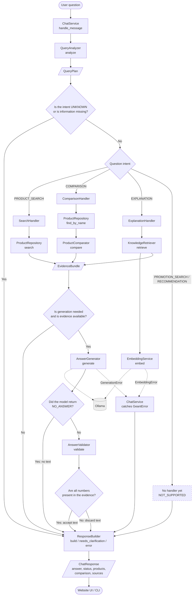
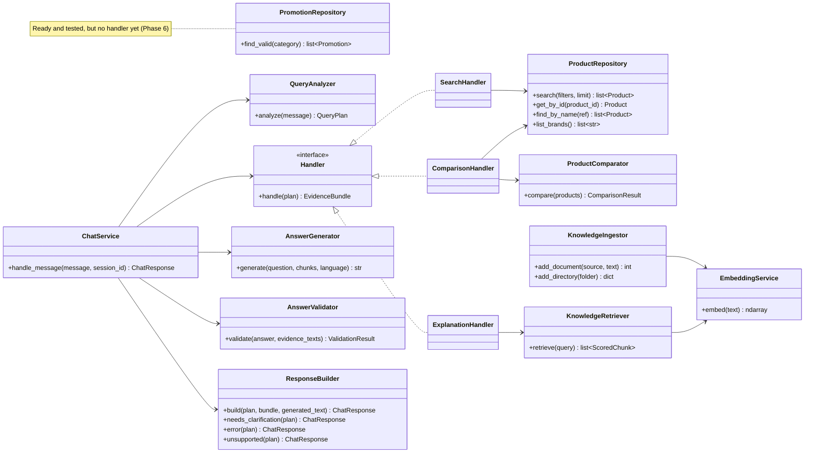
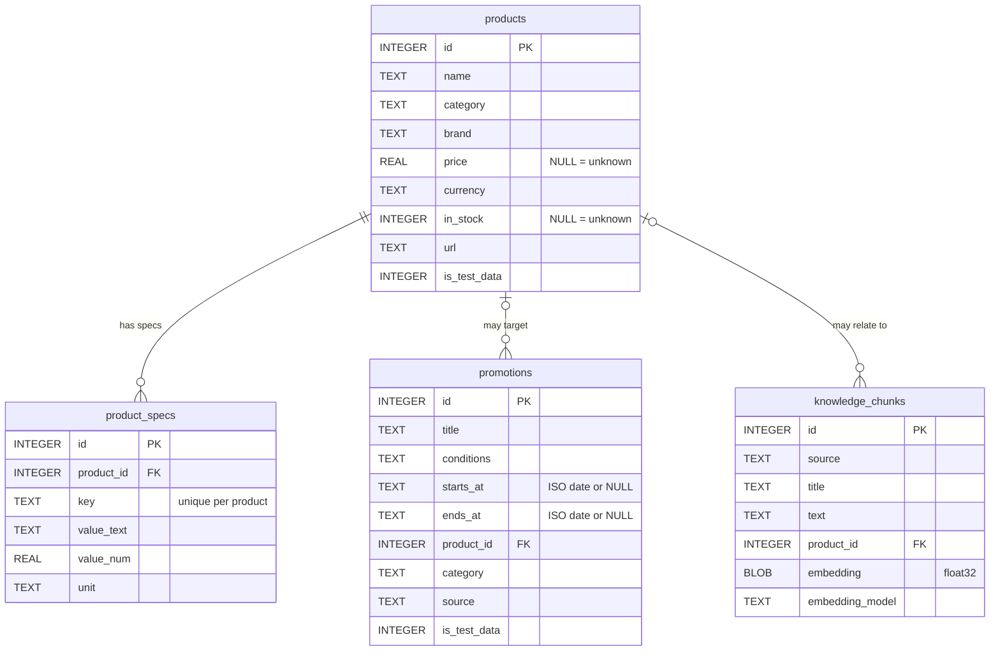
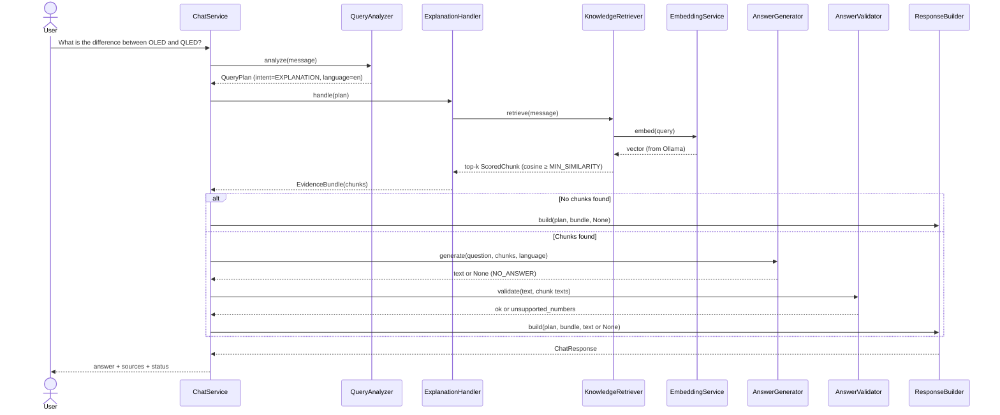

# Sales AI

An AI-powered sales assistant for an e-commerce website. The system combines three capabilities with separate responsibilities:

| Capability | Implemented through | Purpose |
|---|---|---|
| **Structured search** | SQLite + `ProductRepository` | Exact filtering by price, category, brand, and specifications |
| **Knowledge retrieval (RAG)** | Ollama embeddings + NumPy | Find relevant passages for knowledge and explanation questions |
| **Answer generation** | Local LLM through Ollama | Explain retrieved passages in simple language |

> **Core rule:** The language model is **not the source of truth**. Prices, availability, specifications, and promotion dates must come from the database. The model is used to formulate explanations, not to invent commercial facts.

> **Important:** All products and promotions in this project are **mock test data** (`is_test_data = 1`). The project contains no real Géant products, prices, or offers.

---

## Current Status

| Feature | Status | Notes |
|---|---|---|
| F01 — Intelligent product search | ✅ Implemented | Extracts search criteria from English messages only |
| F02 — Product and concept explanations | ✅ Implemented | RAG + LLM + deterministic numeric checks |
| F03 — Product comparison | ✅ Implemented | Compares products by name; missing values are shown as `n/a` rather than invented |
| F04 — Personalized recommendations | ⏳ Not implemented | The intent is detected, but the response is `not_supported` |
| F05 — Offers and promotions | ◐ Partial | `PromotionRepository` and validity rules are ready, but no handler exists yet |
| F06 — Multilingual conversations | ◐ Partial | Fixed responses in Arabic, French, and English; question understanding is English-only; Algerian Darija is not supported |
| F07 — Website integration | ◐ Partial | Structured `ChatResponse` is ready; the FastAPI layer has not been built |

### What Has and Has Not Been Verified

- ✅ **160 unit and integration-component tests using fakes** pass without Ollama.
- ✅ The complete request lifecycle (`ChatService`) is tested with fake generator and retriever components, including error paths.
- ✅ `main.py` runs without Ollama: product search, comparison, and clarification work.
- ⚠️ **The project has not been tested against a real Ollama server.** The `embed` and `chat` calls are implemented against the `ollama` library but have only been tested with fake clients.
- ⚠️ `MIN_SIMILARITY` has not been tuned; `0.5` is an initial guess. The actual quality of generated answers has not been evaluated.
- ⚠️ The project has been tested with Python 3.12.

---

## Architecture

### Request Lifecycle



- Dashed arrows indicate a dependency on an external service (Ollama) or an error path.
- The dashed `NOT_SUPPORTED` node represents an intent whose handler has not yet been implemented (Phase 6).
- Every request path ends at `ResponseBuilder`, which produces a unified `ChatResponse`.

### Components and Dependencies



### Database Model



### Detailed Example: A Knowledge Question (RAG)



### File and Component Responsibilities

| Type | Example | Allowed responsibilities | Responsibilities it should not have |
|---|---|---|---|
| **Data model** | `QueryPlan`, `Product`, `EvidenceBundle`, `ChatResponse` | Carry data | Business logic or I/O |
| **Repository** | `ProductRepository`, `PromotionRepository` | SQL and converting rows into objects | Generating text or embeddings |
| **Retrieval component** | `KnowledgeRetriever`, `EmbeddingService` | Finding relevant chunks and calling Ollama for embeddings | Deciding whether a claim is true |
| **Handler** | `SearchHandler`, `ComparisonHandler`, `ExplanationHandler` | Gathering evidence for one intent | Composing the final response |
| **Service** | `ChatService`, `QueryAnalyzer`, `ResponseBuilder`, etc. | Coordinating a workflow or handling one specific application responsibility | Direct SQL scattered across the application |

---

## Project Structure

```text
geant_sales_ai/
├── main.py                       # Composition root + command-line interface
├── requirements.txt
├── pytest.ini                    # pythonpath = . (allows pytest to find packages)
├── core/
│   ├── config.py                 # All settings (constants only)
│   ├── exceptions.py             # GeantError, EmbeddingError, GenerationError
│   └── formatting.py             # format_number
├── models/                       # Data only (immutable dataclasses)
│   ├── query_plan.py             # Intent, Comparison, SpecConstraint, ProductFilters, QueryPlan
│   ├── product.py                # Spec, Product
│   ├── chunk.py                  # Chunk, ScoredChunk
│   ├── promotion.py              # Promotion
│   ├── comparison.py             # ComparisonRow, ComparisonResult
│   ├── evidence.py               # EvidenceBundle
│   └── chat_response.py          # Status, Source, ChatResponse
├── db/
│   ├── schema.sql                # Database tables
│   ├── database.py               # connect, init_schema
│   └── seed_test_data.py         # Mock test data (+ add_product, add_promotion)
├── repositories/
│   ├── product_repository.py
│   └── promotion_repository.py
├── rag/
│   ├── embedding_service.py      # The only component that calls Ollama for embeddings
│   ├── knowledge_ingestor.py     # Write path: split documents and embed them
│   └── knowledge_retriever.py    # Read path: similarity search (cosine)
├── services/
│   ├── query_analyzer.py         # Message -> QueryPlan (deterministic rules)
│   ├── product_comparator.py     # Deterministic comparison
│   ├── answer_generator.py       # Ollama chat
│   ├── answer_validator.py       # Numeric checks
│   ├── response_builder.py       # Message templates + ChatResponse construction
│   └── chat_service.py           # Coordinates the request lifecycle
├── handlers/
│   ├── __init__.py               # Handler (Protocol)
│   ├── search_handler.py
│   ├── comparison_handler.py
│   └── explanation_handler.py
├── data/knowledge/               # Experimental knowledge documents (not official content)
└── tests/                        # 13 files, 160 tests
```

---

## Installation and Running

Requirements: Python 3.10 or later (the project uses the `X | None` type syntax), and Ollama for the explanation path only.

**Windows (PowerShell):**
```powershell
python -m venv .venv
.venv\Scripts\Activate.ps1
pip install -r requirements.txt
pytest -q                       # Expected: 160 passed
python -m db.seed_test_data      # Creates data\geant.db with test data
```

**Linux / macOS:**
```bash
python3 -m venv .venv && source .venv/bin/activate
pip install -r requirements.txt
pytest -q
python -m db.seed_test_data
```

> Run `python -m db.seed_test_data` (not `python db/seed_test_data.py`) so the project root is on the import path.

### Explanation Path (Requires Ollama)

```bash
ollama pull nomic-embed-text
ollama pull qwen2.5:3b
python main.py --ingest         # Embeds .txt and .md files in data/knowledge
python main.py                  # Starts the command-line chat; type exit to quit
```

Product search and comparison **do not require Ollama at all**.

### Examples (Actual Output on Test Data)

```text
you> Find a laptop under 100,000 DZD with at least 16 GB RAM
[ok] I found 1 matching product(s). Prices and availability come from the product catalogue.
  - TEST-LAPTOP-01 | 95000 DZD | in stock

you> Compare TEST-LAPTOP-01 and TEST-LAPTOP-02
[ok] Comparison of TEST-LAPTOP-01 / TEST-LAPTOP-02. "n/a" means the value is not recorded in the catalogue.
price: 95000 DZD | 60000 DZD
ram_gb: 16 GB | 8 GB
storage_gb: 512 GB | 256 GB

you> Compare TEST-LAPTOP-01 and Ghost
[product_not_found] I couldn't find these products in the catalogue: Ghost.

you> I want something under 50000 DZD
[needs_clarification] Which kind of product are you looking for (for example a laptop or a TV)?
```

---

## Using `ChatService` Programmatically

```python
from db.database import connect
from core.config import DB_PATH
from main import build_chat_service

conn = connect(DB_PATH)
service = build_chat_service(conn)
response = service.handle_message(
    "Find a laptop under 100,000 DZD with at least 16 GB RAM"
)

print(response.status, response.answer)
for product in response.products:
    print(product.name, product.price, product.currency)
```

### `ChatResponse` Structure (for Website Integration)

| Field | Type | Meaning |
|---|---|---|
| `answer` | `str` | Display text (a fixed template or checked generated text) |
| `status` | `Status` | **The website should make display decisions based on this field, not on the answer text.** |
| `intent` | `Intent` | Detected intent |
| `language` | `str` | `en` / `fr` / `ar` / `unknown` |
| `products` | `tuple[Product, ...]` | Data for product cards |
| `comparison` | `ComparisonResult \| None` | Comparison table |
| `sources` | `tuple[Source, ...]` | Sources for explanations |
| `promotions` | `tuple[Promotion, ...]` | Reserved for promotion support |

| Status | Meaning |
|---|---|
| `ok` | Success |
| `no_results` | No products matched the search |
| `product_not_found` | A product named in a comparison was not found |
| `insufficient_evidence` | There is not enough evidence for an explanation, or the generated answer was rejected |
| `needs_clarification` | Information is missing or ambiguous; ask a clarifying question |
| `not_supported` | The intent is recognized but its handler has not been implemented |
| `error` | An expected operational error occurred (for example, Ollama is unavailable) |

> `to_dict()` and the FastAPI layer have not been implemented yet. At that point, decide between `dataclasses.asdict` and Pydantic models.

---

## Design Decisions

- **`None` means “unknown,” not zero:** A product with no recorded price must not appear in a “below 100,000” result. Missing comparison values are shown as `n/a`, not invented.
- **Not every question needs an LLM:** Search and comparison are deterministic. The model is called only for the explanation path, and only after evidence has been retrieved.
- **Semantic similarity is not factual correctness:** `KnowledgeRetriever` indicates that a passage is relevant to the question; it does not prove the passage or an answer is true. `AnswerValidator` therefore checks that every number in a generated answer appears in the evidence. Otherwise, the answer is discarded and the response becomes `insufficient_evidence`. This is a useful guardrail, not proof of correctness.
- **Use `NO_ANSWER` instead of searching for the phrase “not found”:** A language-independent sentinel avoids breaking when the question or response is in Arabic or French.
- **Promotions use deliberately strict rules:** An offer is displayed only when both its start and end dates are known and the current date is within the inclusive validity interval. An offer without an end date is not treated as valid.
- **User input must never be interpolated directly into SQL:** Values are passed as parameters (`?`), and operators come from a closed allowlist.
- **Dependency injection instead of internal construction:** Each class receives its dependencies through its constructor instead of creating them itself. This allows tests to run without Ollama. `main.py` is the single composition root.
- **Separate reads from writes:** `KnowledgeRetriever` and `ProductRepository` are read-only; `KnowledgeIngestor` handles ingestion and writes.
- **Expected operational errors versus programming errors:** `ChatService` catches only `GeantError`. An Ollama outage becomes a controlled `error` response, while programming errors remain visible rather than being silently hidden. Product search continues to work when Ollama is unavailable.

---

## Configuration (`core/config.py`)

| Constant | Default | Notes |
|---|---|---|
| `DB_PATH` | `data/geant.db` | |
| `OLLAMA_HOST` | `http://localhost:11434` | |
| `EMBED_MODEL` | `nomic-embed-text` | Changing this requires re-embedding the knowledge base with `--ingest` |
| `LLM_MODEL` | `qwen2.5:3b` | |
| `OLLAMA_TIMEOUT_SECONDS` | `60` | |
| `TOP_K` | `4` | Maximum number of chunks passed to the model |
| `MIN_SIMILARITY` | `0.5` | **Initial guess; must be tuned experimentally** |
| `TEMPERATURE` / `NUM_PREDICT` | `0.2` / `400` | |
| `MAX_PRODUCT_RESULTS` | `10` | |
| `MAX_CHUNK_CHARS` | `800` | Maximum chunk length during ingestion |

### Tuning `MIN_SIMILARITY`

If reasonable questions are rejected as `insufficient_evidence`, or irrelevant passages are accepted, inspect the actual retrieval scores for representative questions:

```python
from core.config import DB_PATH
from db.database import connect
from rag.embedding_service import EmbeddingService
from rag.knowledge_retriever import KnowledgeRetriever

retriever = KnowledgeRetriever(
    connect(DB_PATH),
    EmbeddingService(),
    min_similarity=-1.0
)
for scored in retriever.retrieve("your question here"):
    print(round(scored.score, 3), scored.chunk.title, "|", scored.chunk.text[:60])
```

---

## Tests

```bash
pytest -q                       # Run all tests
pytest tests/test_chat_service.py -v
```

| File | Count | Coverage |
|---|---:|---|
| `test_query_analyzer.py` | 30 | Intent, prices, specifications, ambiguity, language |
| `test_product_repository.py` | 29 | Filters, NULL handling, sorting, `find_by_name`, SQL injection |
| `test_chat_service.py` | 17 | Full request lifecycle, clarification, errors, rejection of unsupported numbers |
| `test_knowledge_retriever.py` | 12 | Similarity, threshold, model and dimensions, ingestion and rollback |
| `test_models.py` | 11 | Data models |
| `test_response_builder.py` | 11 | Statuses and languages |
| `test_answer_validator.py` | 9 | Numbers and normalization |
| `test_database.py` | 8 | Schema constraints (foreign keys, dates, CHECK constraints) |
| `test_embedding_service.py` | 8 | Error wrapping and BLOB conversion |
| `test_product_comparator.py` | 7 | Differences and missing values |
| `test_answer_generator.py` | 6 | Prompt, refusal, and errors |
| `test_handlers.py` | 6 | The three handlers |
| `test_promotion_repository.py` | 6 | Validity, dates, and boundaries |

**Test types:**
- **Unit tests:** The tests above run without Ollama or network access, using an in-memory SQLite database and fake clients.
- **Real Ollama integration tests:** Not implemented yet.
- **End-to-end tests:** `test_chat_service.py` exercises the full request flow, but uses fake Ollama-related components.

---

## Extending the Project: Adding a New Intent

Example: adding `PROMOTION_SEARCH`.

1. **Create a handler** in `handlers/`: a class with `handle(plan) -> EvidenceBundle` that obtains promotions from `PromotionRepository.find_valid`.
2. **Register it** in `main.build_chat_service`: map `Intent.PROMOTION_SEARCH` to the new `PromotionHandler(...)`.
3. **Format the result** in `ResponseBuilder`: add a branch to `build`, provide message templates in the three supported response languages, and pass promotions through `ChatResponse`.
4. **Add tests** for the handler and response behavior.

`ChatService` should not need to change.

---

## Known Limitations

- Question understanding (intent and filter extraction) works **only in English**. Arabic and French messages can be language-detected and receive clarification messages in the detected language, but their filters are not extracted.
- Algerian Darija written in Latin characters is classified as English.
- A concept comparison such as “OLED vs QLED” is interpreted as a product comparison and ends in `product_not_found`. Use a question such as “What is the difference between OLED and QLED?” instead.
- The `laptop` and `tv` categories in `QueryAnalyzer` are defaults for test data and must be replaced or aligned with the real catalog categories.
- “Laptop with 16 GB RAM” is interpreted as “at least 16 GB”; this assumption is documented in tests.
- SQLite `COLLATE NOCASE` handles English/Latin case-insensitivity only, not Arabic or accented characters.
- Price filters do not check currency; all current test data uses DZD.
- `AnswerValidator` does not detect numbers written as words or non-numeric factual errors.
- Knowledge chunks are loaded from the database for every question. This is suitable for hundreds of chunks; add caching if measurement shows it is needed.
- A SQLite connection is not shared across multiple threads by default. This must be addressed when adding FastAPI.
- Conversation history is not implemented yet; `session_id` is accepted but currently unused.

## Roadmap — Phase 6 and Beyond

1. Add real integration tests with Ollama and tune `MIN_SIMILARITY`.
2. Implement `PromotionHandler` (the repository is ready).
3. Add Arabic and French filter extraction, followed by Algerian Darija support.
4. Implement `NeedsAnalyzer` and `ProductRanker` for recommendations with reasons grounded in real data.
5. Add `ConversationManager` for follow-up questions and language continuity.
6. Add FastAPI and `to_dict()` or equivalent response serialization for the website.
7. Improve `find_by_name` with typo tolerance and include availability in comparisons.
